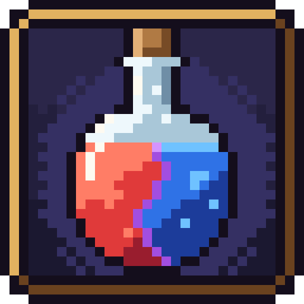

# Potion Mixer

<p align="center"></p>

A WoW Forever (client 1.60.1) addon that adds four buttons in two pairs: **healing and mana potions**, and **food and drink**. Each button always uses the best item of its kind in your bags. It shows that item's icon, how many you carry, the key bound to it and, for potions, the time left on the potion cooldown.

## What it does

- **Two pairs, placed independently.** The potion pair (healing left, mana right) sits below your character by default, and the food and drink pair (food left, drink right) sits just under it. The two buttons of a pair stay together: moving one moves both. Each pair moves without the other.
- **Forever look:** the buttons are 45×45 and drawn with WoW Forever's own action button art (frame, rounded icon, pressed and mouseover states, cooldown swipe, hotkey and count fonts), so they match your action bars.
- **Best item first.** The ranking is redone every time your bags change, so something better you loot or buy is picked up without a `/reload`. When the top stack runs out, the button falls to the next one.
- **Tooltip:** the top item's normal tooltip, then every item of that kind you carry, best first, for example `Major Healing Potion  x5  (1050-1750)` or `Conjured Sweet Roll  x20  (2065)  conjured`. The one the button will use is marked `>` in green. Items you can't use yet, for example because your level is too low, are greyed at the bottom with the reason.
- **Items for both buttons of a pair:** rejuvenation potions restore health and mana, so they appear on both potion buttons. Manna biscuits do the same for food and drink. Each button ranks them by the amount it cares about.
- **Empty button:** with nothing of its kind the button shows a greyed placeholder icon and stays on screen, so you always know where it is.
- **Cooldown:** a swipe plus a countdown in the middle of the icon (`1:45`, then `42`, then `2.5`). Healing and mana potions share one cooldown in Classic-style WoW, so both potion buttons normally show the same timer. That's expected. Food and drink have no cooldown.

## Install

1. Find the folder where your other WoW Forever addons live: `<WoW Forever install>/<flavor folder>/Interface/AddOns/`. The name of the flavor folder (something like `_forever_`) isn't confirmed. Use the one whose `Interface/AddOns` already holds your Forever addons, for example Auctionator.
2. Unzip a release into it (from GitHub Releases, CurseForge or Wago), or copy the `PotionMixer` folder from this repository there. Either way you should end up with `.../Interface/AddOns/PotionMixer/PotionMixer.toc`. When updating, replace the whole folder.
3. Start the game, or type `/reload` if it's running, and check that **Potion Mixer** is enabled in the AddOns list on the character screen, where it shows its flask logo.

When an update adds new files to the addon folder, restart the game instead of using `/reload`: WoW only picks up new files at startup.

The `.toc` declares `## Interface: 16001`, taken from Auctionator's `.toc`. If the AddOns list marks Potion Mixer as *out of date*, type `/dump select(4, GetBuildInfo())` in game, put that number in `PotionMixer.toc`, and `/reload`. Ticking *Load out of date AddOns* also works.

## Usage

| What | How |
|---|---|
| Use the best item | Left-click the button, or press its key |
| Bind keys | Key Bindings → **AddOns** → **Potion Mixer** → *Use best healing potion* / *Use best mana potion* / *Use best food* / *Use best drink*. There are no default keys. |
| Move a pair | **Shift + left-drag** either button of the pair. Both move together, and the other pair stays where it is. This doesn't work in combat, and a drag without Shift does nothing. |
| Reset the positions | `/pmix reset` puts both pairs back at their defaults. It's refused in combat. |
| Show the ranking | `/pmix list` shows every potion, food and drink with the source of its amounts: `[tooltip]` (parsed from the client) or `[data]` (from `Data.lua`). On a German, French or Spanish client these tags appear in that language. |
| Check how an item is read | `/pmix tooltip` followed by the item: Shift-click the item to insert its link, or type its item ID. It prints the item's tooltip lines as the client delivers them, with escape codes visible, and what the addon reads from each line. Send this output along with any detection problem. |
| Help | `/pmix` or `/potionmixer` |

The position of each pair is saved account-wide in `PotionMixerDB`. If you placed the potion pair with version 1.0.0, it keeps its place.

**Languages:** the buttons' tooltips, the chat messages and the key binding names are in English, German, French or Spanish, following your client's language. Spanish (AL) clients (esMX) get Latin American Spanish with the game's Latin American terms, for example "poción de sanación". Other clients get English.

## How potions are found and ranked

An item counts as a healing or mana potion if:

- its item ID is in the `KNOWN_POTIONS` table in `PotionMixer/Data.lua`, **or**
- it is a consumable, isn't in `EXCLUDED_ITEMS`, and its "Use:" line restores health and/or mana **instantly**. "Over N sec" wording (food, drink, bandages) never counts as a potion, and "at the cost of … life" runes are rejected.

The amounts come from the client's own tooltip, parsed for English, German, French and Spanish, for example `Restores 1050 to 1750 health.`, `Stellt 1050 bis 1750 Punkt(e) Gesundheit wieder her.`, `Rend 1050 à 1750 points de vie.` or `Restaura 1050 al 1750 p. de salud.`. An item's "Use:" text comes from its spell, which the client loads only when it's first needed. Until it has arrived, which is typical right after logging in or after switching the client language, the addon asks the client for it and uses the values from `Data.lua` in the meantime (`[data]` in `/pmix list`). The tooltip's amounts take over a moment later. If the tooltip still can't be read, the `Data.lua` values stay. The score is the average of the minimum and maximum. Ties go to the higher maximum, then the higher item level, then the higher item ID.

Healthstones, mana gems, Demonic/Dark Runes and the Whipper Root / Night Dragon's Breath herbs are excluded on purpose: they don't share the potion cooldown. If Forever adds new potions or similar items, add them to the tables at the top of `Data.lua`.

## How food and drink are found and ranked

An item counts as food (health) or drink (mana) if:

- its item ID is in the `KNOWN_FOOD` table in `Data.lua` (vendor bread and water, mage food and water, manna biscuits), **or**
- it is a consumable, isn't in `EXCLUDED_ITEMS`, and its "Use:" line restores health and/or mana **over time while seated**: `Restores 2065 health over 30 sec. Must remain seated while eating.` / `Stellt im Verlauf von 30 Sek. … wieder her. Ihr müsst beim Essen sitzen bleiben.` Bandages and other heal-over-time effects don't say "seated", so they're never offered.

The amount restored decides, with three refinements:

1. **Buff food comes last.** Food that makes you *Well Fed* (on Forever also +5% experience from kills) is kept for when you want the buff: the button eats plain food first and uses buff food only when that's all you carry. To rank buff food like any other food, set `local SAVE_BUFF_FOOD = true` to `false` at the top of `PotionMixer/Potions.lua`.
2. **Conjured first on ties.** Mage food and water restore exactly as much as the bought food of their tier, so the button uses the free conjured items first.
3. Then the higher item level, then the higher item ID.

Each food or drink button always uses just its top item, not a macro. Food and drink have no cooldown, so a macro with several `/use` lines could eat more than one item per click. Since you can't eat or drink in combat, the macro's fall-through (see below) wouldn't help anyway, and out of combat the button follows your bags at once.

## The macro trade-off for potions ("Item is not ready yet")

Secure buttons can't be changed in combat. A plain "use item X" button would therefore stop working the moment its stack ran out mid-fight. Instead, each potion button runs a hidden macro with one `/use item:<id>` line per potion you own, best first. The macro is rebuilt out of combat whenever the ranking changes. In combat, the first line that works is the one that runs, so the button falls through to your next-best potion.

The cost: after a potion is used, the remaining lines try too and can show **"Item is not ready yet"** in red, with the error sound. Only one potion is ever used per press.

If you'd rather not see those errors, open `PotionMixer/Buttons.lua` and change

```lua
local ACTION_MODE = "macro"
```

to

```lua
local ACTION_MODE = "item"
```

The potion buttons then use only the top potion. When that stack runs out in combat, they switch to the next potion only after combat ends.

## Known limitations

- **Mid-fight changes wait for combat to end.** The icon and count always show the truth, but what a click does is fixed when combat starts. A potion you loot during a fight is shown at once and is only used after combat. With the macro, a potion that runs out is skipped automatically.
- **No eating or drinking in combat.** That's the game's rule. The food and drink buttons keep showing what you'll use once the fight is over.
- **Shift + hotkey does nothing.** Shift + left button is reserved for moving, so pressing a bound key while holding Shift uses nothing. Ctrl or Alt + the key still works.
- **Minor Discolored Healing Potion** (Forever) ranks by its instant 150–170 health. The damage over time it deals afterwards (75% of the amount) isn't counted. It ties with Lesser Healing Potion on score, and Lesser wins on its higher maximum.
- **Locales:** tooltip parsing covers English (enUS/enGB), German (deDE), French (frFR) and Spanish (esES, esMX). The French and Spanish wording was checked against WoW Forever's frFR, esES and esMX tooltips. Latin American Spanish words its tooltips almost exactly like European Spanish. On other clients (for example Russian or Portuguese), only items listed in `Data.lua` are found (no buff food, which isn't listed), and their amounts come from `Data.lua`.
- **Empty-button cooldown:** an empty potion button shows the cooldown of its placeholder item. Some clients report no cooldown for items you don't own, and then the empty button shows none.
- The addon's own texts are translated into German, French and Spanish. Other languages see English. The `/pmix tooltip` diagnostic output is always in English.
- Not integrated with Edit Mode. Move the pairs with Shift-drag.
- The buttons always use the main-bar frame. If you turn on Edit Mode's *Hide Bar Art*, Forever switches its own bars to a slightly larger frame, and these buttons won't follow.

## In-game test checklist

Run these once on WoW Forever and note anything that doesn't match the expected result.

| # | Do this | Expected |
|---|---|---|
| 1 | `/console scriptErrors 1`, then `/reload` with no potions, food or drink in your bags | All four buttons show greyed placeholders (Minor Healing Potion, Minor Mana Potion, Tough Hunk of Bread, Refreshing Spring Water). No counts. No Lua errors. |
| 2 | Carry Minor and Lesser Healing Potions | The healing button shows Lesser with the right count. The tooltip lists Lesser (marked `>`) above Minor. |
| 3 | Loot or buy a better potion | The button switches to it without a `/reload` |
| 4 | Use the potion by click and by hotkey | Exactly one potion is used per press. The swipe and countdown appear on **both** potion buttons, not on food or drink. |
| 5 | Shift-drag the healing button, then the mana button; plain-drag a button; `/reload`; log out and back in | Each Shift-drag moves both potion buttons together, keeps their spacing, leaves the food pair where it is and uses nothing. A plain drag doesn't move them. The position survives the reload and the relog. |
| 6 | In combat: Shift-drag a button. Then use up the top potion stack, wait for the cooldown, press again. Leave combat. | Shift-drag does nothing, and there are no "Interface action blocked" messages. After the cooldown, the next press uses the next-best potion. After combat, the icons and `/pmix list` match your bags. |
| 7 | Bind, then unbind, a key for each of the four buttons in Key Bindings → AddOns → Potion Mixer | The hotkey text on the button appears and disappears at once |
| 8 | `/pmix reset` out of combat, then in combat | Out of combat: both pairs return to their default positions. In combat: refused with a message. |
| 9 | On a low-level character, carry a potion and a drink above your level (for example a Major Healing Potion and Morning Glory Dew) | Neither is chosen. Each appears greyed at the bottom of its tooltip with "Requires Level …". |
| 10 | On a German, French or Spanish client (deDE, frFR, esES, esMX), if available: carry a potion, conjured food, buff food and a drink, then `/pmix list` | Potions, food and drink show `[tooltip]`, meaning their amounts were parsed from that language's tooltip. The conjured food and the buff food are tagged in your language (German: `herbeigezaubert`, `Satt`). The tooltips, chat messages and key binding names are in that language too. |
| 11 | Carry bread and water; click the food button, then the drink button | One item each is used and you sit and eat/drink. The counts go down by one. |
| 12 | Carry conjured food and bought food of the same tier (for example Conjured Sweet Roll and Homemade Cherry Pie) | The conjured food is on top and is eaten first. The tooltip tags it `conjured`. |
| 13 | Carry buff food (for example Smoked Desert Dumplings) and plain food | Plain food is used first. The buff food is listed after it, tagged `Well Fed`, and is only used once the plain food is gone. |
| 14 | Carry an Enriched or Alterac Manna Biscuit | It appears on both the food and the drink button |
| 15 | In combat: click the food button; loot food. Leave combat. | Nothing is eaten (the game refuses), no "Interface action blocked", and the food button keeps showing your best food, not a greyed placeholder. After combat, a click eats it. |
| 16 | Shift-drag the food or drink button; `/reload` | Only the food and drink pair moves, and its position survives the reload |
| 17 | Switch the client language (or clear the game's cache), log in, and run `/pmix list` twice: once right away, then again a few seconds later | The first list may show `[data]`. The second shows `[tooltip]` for every item whose text is parsed (potions, food and drink in English, German, French and Spanish). Buff food that isn't in `Data.lua` appears by the second list at the latest. |
| 18 | `/pmix tooltip` with a Shift-clicked potion link | The item's tooltip lines, the "Use:" line marked `-> instant, health …` |

These checks cover points that couldn't be verified without the game:

| # | Do this | Expected |
|---|---|---|
| 19 | Shift-click, and Shift+Alt-click, a button that has an item | Nothing is used. The buttons' Shift actions are set to Blizzard's `ATTRIBUTE_NOOP` (`""`). |
| 20 | Start a Shift-drag, let go of Shift first, then of the mouse button | The pair moves and nothing is used |
| 21 | `/console ActionButtonUseKeyDown 1`, press a potion hotkey; then `/console ActionButtonUseKeyDown 0`, press it again | One potion per press either way: on key down with `1`, on key release with `0`. A double fire can't use two potions, because of the shared cooldown. It would show up as an extra "Item is not ready yet", which is easiest to see with `ACTION_MODE = "item"`. If that happens, register `"AnyUp"` only (`CLICKS` in `Buttons.lua`). For food, a double fire would eat two items: check that one press eats exactly one. |
| 22 | Hover a button, then press and release Shift | Both buttons of that pair get a gold border while Shift is held (the other pair doesn't), and the ranked list stays in the tooltip |
| 23 | Note any red error text after a successful potion use | "Item is not ready yet" is the known macro trade-off (see above). Anything else is unexpected. |
| 24 | Put the buttons next to your action bar and compare them | Same frame, rounded icon corners, mouseover glow, pressed look, cooldown swipe and hotkey/count text. A plain or empty square instead of the frame means an atlas name didn't resolve on this client. |

## Development

`tests/harness.lua` runs the real addon files against a mock of the WoW API and checks the behaviour described above. That covers secure attribute lookup, combat lockdown, bags, tooltips in all four languages, item and spell loading, positions, translations and slash commands. It needs Lua 5.1 or LuaJIT, no game client:

```sh
lua5.1 tests/harness.lua      # or: luajit tests/harness.lua
```

It prints any failed check and ends with `N passed, 0 failed`. Also worth running after a change:

```sh
for f in PotionMixer/*.lua; do luac5.1 -p "$f"; done   # syntax
xmllint --noout PotionMixer/Bindings.xml                # well-formed XML
```

The `tests` folder doesn't go into `Interface/AddOns`. Copy only `PotionMixer`.

The logo is pixel art on a 32 × 32 grid. `python3 logos/make_logos.py` (needs Pillow) draws it and writes `logos/potion-mixer-logo-32/512/1024.png` for the addon websites. It also writes `PotionMixer/Media/Logo.tga`, the icon in the game's AddOns list. When Aseprite is installed (looked up in `$ASEPRITE`, on the PATH and in the Steam library), it also writes `logos/potion-mixer-logo.aseprite`, with the layers *Frame* and *Art* and the palette `logos/potion-mixer.gpl` loaded.

## Releasing

GitHub Actions builds and uploads releases with [BigWigsMods/packager](https://github.com/BigWigsMods/packager). The workflow is `.github/workflows/release.yml`, and the packaging settings are in `.pkgmeta`.

- **Every push and pull request** runs the syntax checks and the test harness.
- **Pushing a tag** also packages the `PotionMixer` folder into a zip, versioned from the tag, with a changelog of the commits since the previous tag. That release step runs only after the tests pass.
- **Where it goes:** the zip is uploaded to GitHub Releases, and to CurseForge and Wago once they're set up as below. WoWInterface has no WoW Forever category, so the packager can't upload there.
- **Game version:** the packager reads interface 16001 from the `.toc` and files each release under WoW Forever (game version 1.60.1).

One-time setup:

1. Push this repository to GitHub.
2. Create the addon's project on CurseForge and/or Wago. Then put the project IDs into `PotionMixer/PotionMixer.toc`, as `## X-Curse-Project-ID: …` and `## X-Wago-ID: …`.
   - CurseForge shows the ID in the "About Project" box.
   - Wago shows it on its developer dashboard.
3. Add each site's API token as a repository secret, under Settings → Secrets and variables → Actions: `CF_API_TOKEN` (CurseForge) and `WAGO_API_TOKEN` (Wago). GitHub's own token is provided automatically.

A site without its project ID or token is skipped, so you can start with GitHub Releases alone.

To release a version, tag it and push the tag:

```sh
git tag -a 1.3.0 -m "Potion Mixer 1.3.0"
git push origin 1.3.0
```

A tag containing `beta` or `alpha`, such as `1.4.0-beta1`, is uploaded as a beta or alpha release. If creating the GitHub release fails with "Resource not accessible by integration", allow read and write permissions for workflows under Settings → Actions → General.

The `.toc` says `## Version: @project-version@`, and the packager replaces that with the tag. A copy taken straight from the repository shows the placeholder as its version in the game.

## License

Copyright (C) 2026 zerfall

Potion Mixer is free software: you can redistribute it and/or modify it under the terms of the GNU Affero General Public License as published by the Free Software Foundation, either version 3 of the License, or (at your option) any later version. It is distributed in the hope that it will be useful, but WITHOUT ANY WARRANTY; without even the implied warranty of MERCHANTABILITY or FITNESS FOR A PARTICULAR PURPOSE. See [LICENSE](LICENSE) for the full text.
